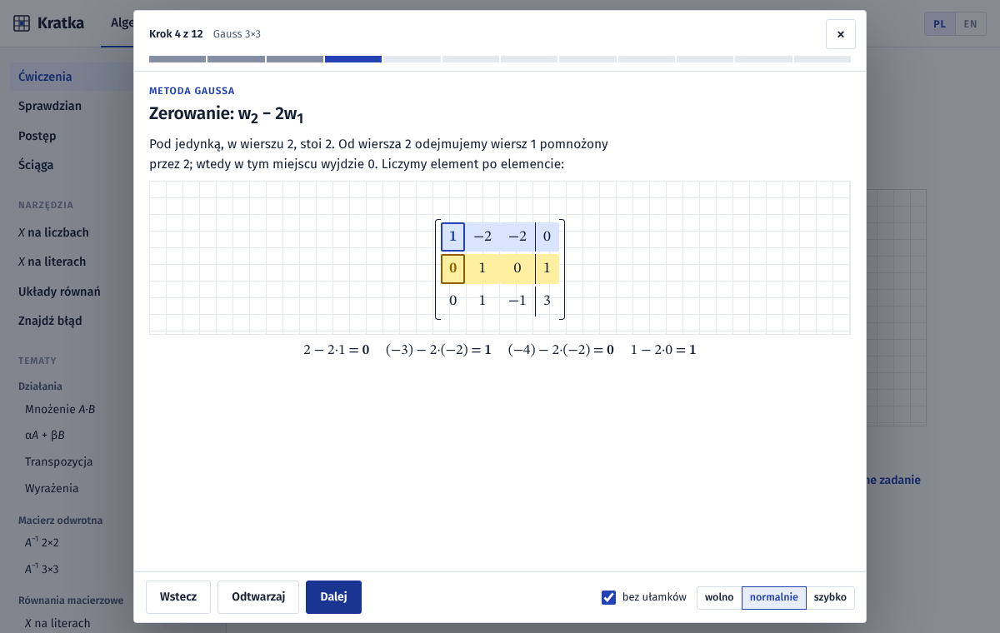
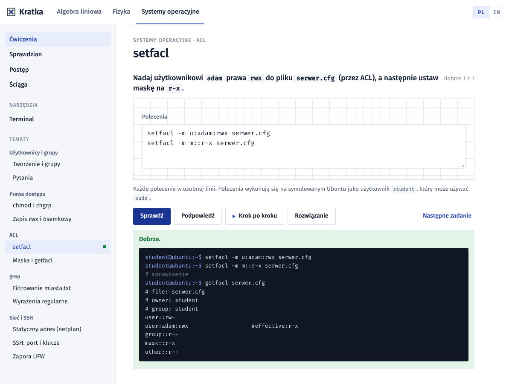
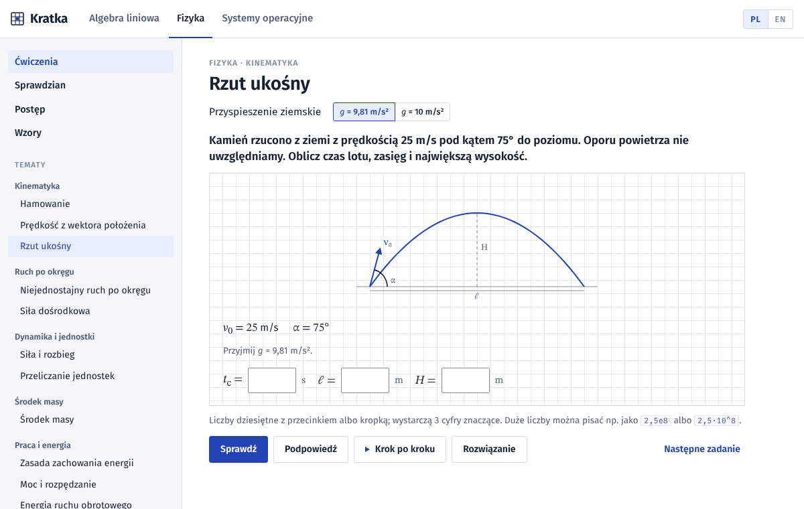
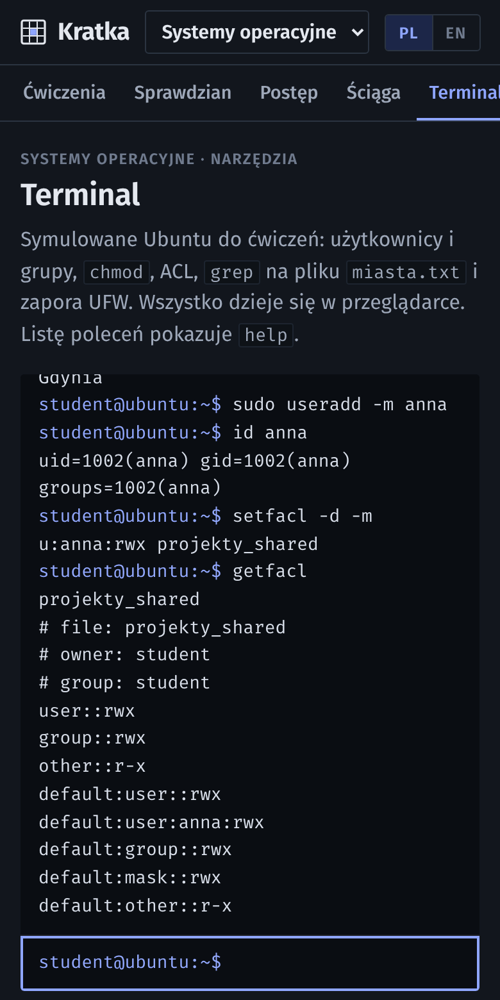

# Kratka

Zadania na kolokwia z algebry liniowej, fizyki i systemów operacyjnych. Kratka losuje zadanie, sprawdza odpowiedź i pokazuje rozwiązanie krok po kroku, tak jak rozpisuje się je na kartce w kratkę.

**https://kapix789.github.io/cld/kratka/**

Działa w przeglądarce, na komputerze i na telefonie. Nie trzeba się logować, nic nie jest wysyłane na serwer, a postęp zapisuje się w przeglądarce. Przełącznik PL / EN zmienia język wszystkiego, łącznie z rozwiązaniami.



## Co można poćwiczyć

### Algebra liniowa

25 typów zadań: działania na macierzach, macierz odwrotna, równania macierzowe (wzór na *X* i liczby), układy równań (Gauss, metoda macierzowa, Cramer, z parametrem, 4×4 „jeśli to możliwe” jak na kolokwium), wyznaczniki (2×2, Sarrus, Laplace, własności) i rząd.

- Wszystko liczy się na ułamkach zwykłych, bez zaokrągleń.
- Eliminacja idzie bez ułamków, tak jak na kartce: jedynka powstaje z kombinacji wierszy, a dzieli się dopiero na końcu. Można to wyłączyć.
- Przy układzie nieoznaczonym sprawdzane jest rozwiązanie ogólne, z dowolnie wybranymi parametrami.
- Narzędzia: rozwiązanie własnego układu, wzór na *X* z dowolnego równania i **Znajdź błąd**, czyli sprawdzenie kroków eliminacji przepisanych z zeszytu ze wskazaniem złej liczby.

### Systemy operacyjne

Polecenia wpisuje się jak w terminalu. Kratka wykonuje je na symulowanym Ubuntu i sprawdza efekt, więc przechodzi każde poprawne rozwiązanie, nie tylko jedno wzorcowe.

- Użytkownicy i grupy (`useradd`, `usermod -aG`, `gpasswd`), prawa (`chmod`, `chgrp`), ACL (`setfacl`, `getfacl`, maska, ACL domyślne), `grep` na pliku `miasta.txt` i zapora UFW.
- Pytania testowe i „dokończ polecenie”: netplan, SSH (port, klucze), wyrażenia regularne, odczytywanie `ls -l` i `getfacl`.
- Po sprawdzeniu widać zapis terminala i polecenie, którym sprawdza się wynik (`id`, `ls -ld`, `getfacl`, `ufw status`).
- Osobny terminal do swobodnych ćwiczeń.



### Fizyka

12 typów zadań z mechaniki: hamowanie, prędkość i przyspieszenie z wektora położenia (pochodne), rzut ukośny, niejednostajny ruch po okręgu, siła dośrodkowa, rozbieg samolotu, przeliczanie jednostek, środek masy, zasada zachowania energii, moc, energia ruchu obrotowego, okres obiegu po orbicie.

- Wynik sprawdzany jest z tolerancją, a przy pomyłce o 10ⁿ albo o 3,6 (km/h zamiast m/s) pojawia się podpowiedź.
- *g* = 9,81 albo 10 m/s², do wyboru nad zadaniem.
- Rozwiązania krok po kroku z rysunkiem, np. tor rzutu albo wektory na okręgu.



## Jak się z tego korzysta

1. Wybierz przedmiot u góry i temat z listy po lewej (na telefonie z rozwijanej listy).
2. Rozwiąż zadanie na kartce, wpisz wynik i kliknij **Sprawdź**.
3. Jeśli nie wychodzi: **Podpowiedź**, **Rozwiązanie** albo **Krok po kroku**. Ten ostatni odtwarza rozwiązanie na kratce, krok za krokiem, z zaznaczonymi wierszami, rysunkiem albo terminalem.
4. **Sprawdzian** losuje 5–10 zadań z wybranych działów, z limitem czasu albo bez, i na końcu wystawia ocenę od 2,0 do 5,0.
5. **Postęp** pokazuje wyniki 10 ostatnich prób z każdego tematu. **Powtórka** częściej losuje tematy, które idą słabo.
6. **Ściąga** (w fizyce **Wzory**) zbiera definicje, twierdzenia, przepisy i najczęstsze błędy.



## Dla programisty

Kratka to jedna strona HTML składana z plików w `src/`. Nie ma frameworków ani zależności, potrzebne są tylko Python 3 (do budowania) i Node 18+ (do testów).

```
src/
  core.js        język, rejestr przedmiotów (addSubject) i rodzajów odpowiedzi (KINDS)
  engine.js      matematyka: ułamki, macierze, eliminacja Gaussa, równania, klatki animacji
  app.js         wspólny interfejs: nawigacja, ćwiczenia, sprawdzian, postęp, odtwarzacz
  page.html      szkielet strony
  style.css      wygląd (jasny i ciemny motyw)
  algebra/       topics.js (tematy), tools.js i page.html (narzędzia, ściąga)
  fizyka/        topics.js (tematy, rysunki, odpowiedź z tolerancją), page.html (wzory)
  so/            linux.js (symulator Ubuntu), topics.js, tools.js i page.html (terminal, ściąga)
build.py         składa src/ w index.html
tests/           testy każdego przedmiotu, bez przeglądarki
```

```sh
python3 build.py                  # po każdej zmianie w src/
node tests/algebra.test.js        # losuje zadania z każdego tematu i sprawdza je
node tests/fizyka.test.js
node tests/so.test.js
```

### Nowy temat

Temat to jeden obiekt w tablicy tematów przedmiotu (np. `TOPICS` w `src/algebra/topics.js`). Ćwiczenia, sprawdzian, postęp i powtórka biorą go stamtąd sami.

```js
{ id: 'slad', sec: 'Działania', name: 'Ślad macierzy', en: 'Trace of a matrix', gen: () => {
    const A = M.make(3, 3, () => F(rnd(-5, 9)));            // losowa macierz 3×3 (ułamki Fr)
    const tr = A.reduce((s, r, i) => s.add(r[i]), F(0));   // suma przekątnej
    return {
      q: $t('Oblicz ślad macierzy <i>A</i>', 'Compute the trace of <i>A</i>'),
      body: givenH([['A', A]]),
      ans: { kind: 'num', v: tr, lab: 'tr <i>A</i>' },
      sol: $t('<p>Ślad to suma liczb na przekątnej.</p>', '<p>The trace is the sum of the diagonal.</p>'),
      hint: $t('Dodaj liczby na przekątnej.', 'Add up the diagonal.'),
      // fr: () => [...]  klatki „krok po kroku” (format opisany w app.js)
    };
}},
```

`id` musi być stałe, bo pod nim zapisuje się postęp. Teksty pisze się w obu językach przez `$t('po polsku', 'in English')`, a w plikach HTML jako `⟪po polsku⫽in English⟫`. Gotowe rodzaje odpowiedzi to `mat`, `num`, `formula`, `sys`, `param` (algebra), `qty` (liczba z jednostką i tolerancją), `cmd` (polecenia sprawdzane w symulatorze), `choice` i `fill`. Nowy rodzaj dopisuje się do `KINDS`.

### Nowy przedmiot

1. Folder `src/<id>/` z plikiem `topics.js`, który na końcu wywołuje `addSubject({ id, name, en, topics, secEn, prKey, sheet, tools })` (opis pól jest w `src/core.js`).
2. Opcjonalnie `page.html` ze ściągą (`<section data-view="sciaga" data-subj="<id>">`) i widokami narzędzi oraz `tools.js` z ich kodem.
3. `<id>` na listę `SUBJECTS` w `build.py` i w `tests/load.js`, test w `tests/<id>.test.js`.

Przedmiot od razu dostaje swoją zakładkę, ćwiczenia, sprawdzian, postęp i adresy w rodzaju `#<id>-cwiczenia`.

## English

Kratka is a practice tool for university exams in linear algebra, physics and operating systems. It generates tasks, checks your answers and replays the solution step by step on squared paper. The operating systems part runs your shell commands on a simulated Ubuntu and checks the result. Use the PL / EN switch in the header to change the language of everything, including the solutions.
